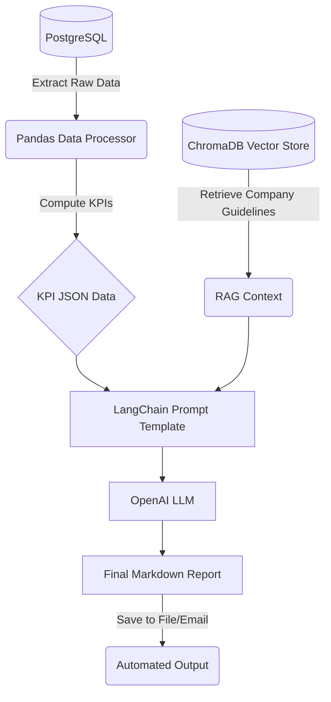

# AutoFlow — GenAI Workflow Automation

AutoFlow is a backend automation engine that extracts raw data from a PostgreSQL database, computes Key Performance Indicators (KPIs) using `pandas`, and uses Generative AI (LangChain + OpenAI) augmented with RAG (ChromaDB) to write deterministic, highly-actionable executive summaries.

It replaces the manual work of staring at dashboards by running an automated pipeline via a cron job every Monday morning.

## 🚀 Features
- **SQL Data Extraction**: Connects to PostgreSQL via SQLAlchemy.
- **Data Processing**: Computes trailing 7-day and 14-day KPIs (Revenue Growth, New Signups, Average Order Value) using `pandas`.
- **RAG Engine**: Uses ChromaDB to embed company guidelines, goals, and tone requirements so the LLM output is grounded in actual business context.
- **GenAI Brain**: Uses LangChain and OpenAI (`gpt-4o-mini`) to synthesize the raw math and the RAG context into a readable markdown report.
- **Workflow Automation**: Uses the `schedule` library to automate end-to-end execution.

## 🧠 Architecture



## 🛠️ Quick Start

### 1. Installation
Clone the repository and install the dependencies:
```bash
git clone https://github.com/SHAILESH-RS-UPADHYAY/autoflow.git
cd autoflow
python -m venv venv
source venv/bin/activate  # Windows: .\venv\Scripts\activate
pip install -r requirements.txt
```

### 2. Environment Variables
Copy `.env.example` to `.env` and add your OpenAI API key:
```bash
cp .env.example .env
```

### 3. Setup the Database
Make sure you have a PostgreSQL database running locally (or update the `DATABASE_URL` in the scripts to point to your Cloud SQL instance). Then, generate the mock data:
```bash
python database.py
```

### 4. Build the RAG Engine
Embed the company guidelines into the local ChromaDB instance:
```bash
python rag_engine.py
```

### 5. Run the Engine
You can test the entire pipeline (extraction, analytics, RAG retrieval, and LLM generation) by running:
```bash
python main.py
```
This will generate a `weekly_report_YYYY_MM_DD.md` file in your directory.

---
*Built to showcase the intersection of traditional data engineering and modern GenAI workflow automation.*
