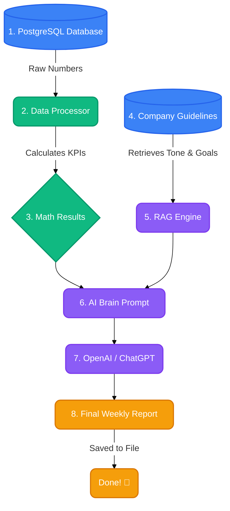

<p align="center"></p>

# ✨ AutoFlow: GenAI Workflow Automation

Welcome to **AutoFlow**! 👋 

AutoFlow is a smart, automated robot for your business. Instead of a human spending hours staring at dashboards and writing weekly reports, AutoFlow does it automatically. It pulls the raw numbers from your database, calculates how your business is doing, reads your company goals, and uses AI to write a perfect, easy-to-read executive summary. 

It runs completely on its own, every Monday morning! ☕

<picture>
  <source media="(max-width: 600px) and (prefers-color-scheme: dark)" srcset="https://shailesh-stats.vercel.app/api/plate?name=repo&amp;repo=autoflow&amp;theme=dark&amp;w=m">
  <source media="(max-width: 600px)" srcset="https://shailesh-stats.vercel.app/api/plate?name=repo&amp;repo=autoflow&amp;theme=light&amp;w=m">
  <source media="(prefers-color-scheme: dark)" srcset="https://shailesh-stats.vercel.app/api/plate?name=repo&amp;repo=autoflow&amp;theme=dark">
  
</picture>

---

## 🌟 What Can AutoFlow Do?

- 📊 **Pulls Data Automatically:** Connects directly to your database (PostgreSQL) to grab the latest sales and user data.
- 🧮 **Does the Math:** Uses Pandas to calculate exactly how much money you made this week and how many new users signed up.
- 🧠 **Understands Your Goals (RAG):** Reads a special database (ChromaDB) to learn your company's tone and quarterly goals so it knows exactly what to focus on.
- 🤖 **Writes Like a Pro:** Uses OpenAI (ChatGPT) to combine the math and your goals into a beautiful, actionable report.
- ⏰ **Never Sleeps:** Runs automatically on a schedule so you wake up to a finished report.

---

## 🎨 How It Works (Visualized)

Here is a simple look at how AutoFlow thinks and acts:



---

## 🚀 Step-by-Step Guide for Beginners

If you want to run this project on your own computer, follow these simple steps!

### Step 1: Download the Code
First, you need to download this folder to your computer. Open your terminal (or command prompt) and type:
```bash
git clone https://github.com/SHAILESH-RS-UPADHYAY/autoflow.git
cd autoflow
```

### Step 2: Set Up the Environment
We need to create a "virtual room" for our project so it doesn't mess with other apps on your computer.
```bash
python -m venv venv
```
Now, turn the room on:
- **On Windows:** `.\venv\Scripts\activate`
- **On Mac/Linux:** `source venv/bin/activate`

Install all the required robot parts (libraries):
```bash
pip install -r requirements.txt
```

### Step 3: Add Your AI Key
AutoFlow needs an OpenAI API key to talk to ChatGPT.
1. Create a copy of the `.env.example` file and rename it to exactly `.env`
2. Open the `.env` file and replace `"sk-your-openai-api-key-here"` with your real OpenAI key.

### Step 4: Create the Mock Database
Run this command to create a fake database filled with 30 days of fake sales data:
```bash
python database.py
```
*(You will see a message saying "Mock data successfully injected!")*

### Step 5: Teach AutoFlow Your Goals
Run this command so AutoFlow can read your company guidelines and save them to its memory:
```bash
python rag_engine.py
```

### Step 6: Start the Engine! 🏎️
You are completely ready. Run the main file:
```bash
python main.py
```
AutoFlow will immediately generate a test report and save it as a Markdown (`.md`) file in your folder. After that, it will stay awake in the background and generate a new report every Monday at 8:00 AM!

---
*Built with ❤️ to showcase the intersection of traditional data engineering and modern GenAI workflow automation.*
